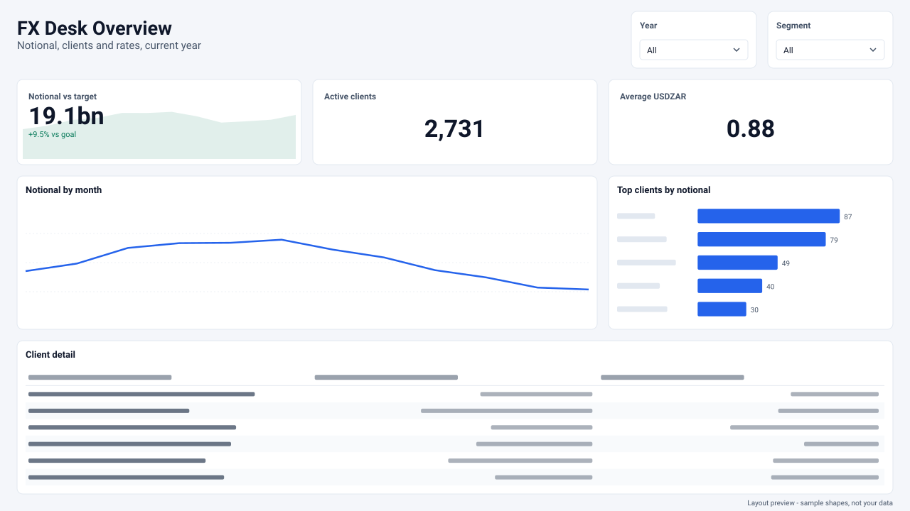
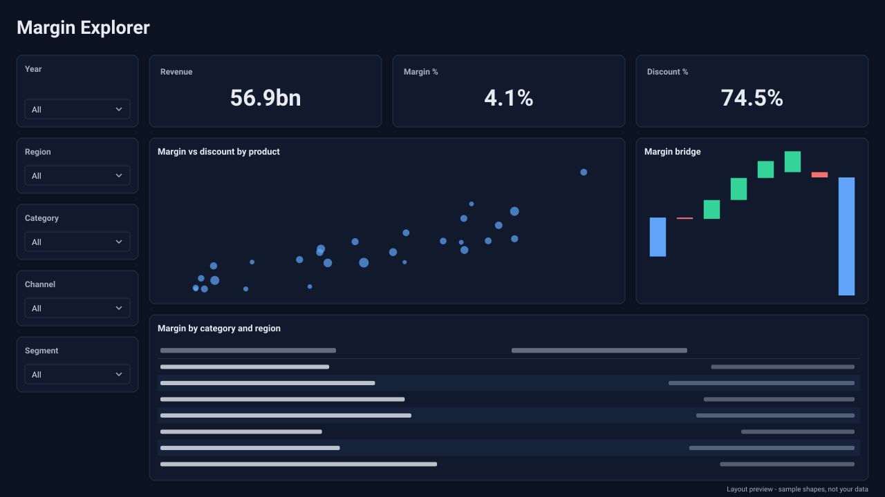

# powerbi — a local Power BI specialist model for Ollama

A Power BI-only model you create in Ollama and run **entirely locally** on a single
24 GB GPU — no cloud API, no data egress. It answers DAX, Power Query M, semantic
modelling, and report-building questions with consultant-grade depth, grounded in
Microsoft's current documentation and your own project, and asks before doing anything
destructive.

- **Base:** `gemma4:26b` — Mixture-of-Experts, 18 GB at Q4_K_M, native Ollama load.
- **Brain:** a ~36 KB rulebook baked in via a `SYSTEM` block (scope lock, DAX / M /
  PBIR standards, TMDL scripting, safety gates, a dashboard design system). It is a
  *system prompt, not weights*, so it moves freely between bases.
- **Dashboard Studio:** a design engine the model drives with a short spec. Layout,
  formatting, accessibility and name checks are done in code, not improvised. See
  [Dashboard Studio](#dashboard-studio).
- **Measured:** **12/12** on the original 12-task smoke test at **~156 tokens/s**. The
  63-task benchmark in `bench/` (model *and* full-system modes, repeated runs, design scored
  by a linter) is the scoreboard from now on. See [Evaluating](#evaluating).

> **Why not the original Qwen3.8 27B hybrid base?** A newer hybrid (attention + SSM)
> architecture that Ollama's current `llama.cpp` backend cannot start within its
> hard-coded 5-minute timeout (upstream regression #18123). The brain was ported onto
> `gemma4:26b` — which already loads natively and is the base the companion RAG layer
> trusts — producing a 26× throughput improvement. See `RUNTIME.md` for the full
> diagnosis.

---

## Quick start (Windows PowerShell)

```powershell
Set-ExecutionPolicy -Scope Process Bypass -Force
cd .\powerbi-llm
.\build.ps1                      # pulls gemma4:26b (18 GB first run), fits context to VRAM, smoke-tests
python refresh_docs.py           # builds the local Microsoft Learn index (~/.powerbi-llm/docs.sqlite)
python bench\bench.py            # 63-task benchmark, 3 repeats, scored and saved
python dashboard_studio.py gallery -o gallery.html   # every layout in every theme, in your browser
ollama run powerbi
```

Everything runtime is Python standard library. Optional: `pip install -r requirements-dev.txt`
(pytest, and `jsonschema` for PBIR schema validation).

`build.ps1`:
1. Checks Ollama and sets GPU-friendly env vars (flash attention, q8_0 KV cache,
   1 parallel slot, 30-min keep-alive) — restarting Ollama if any changed.
2. Pulls the base.
3. Creates `powerbi` at the largest context (up to 64K) that stays 100% in VRAM —
   it loads each size and steps down until nothing spills to system RAM.
4. Runs a smoke test and prints real generation speed.

### Build options

| Option | Use |
|---|---|
| `.\build.ps1 -Base qwen3-coder:30b -Name powerbi-fast` | Faster MoE base (no vision/thinking) |
| `.\build.ps1 -Base qwen3.6:27b-coding` | Alternative dense base |
| `.\build.ps1 -MaxContext 32768` | Cap the context window |

Manual build on any OS:

```powershell
ollama pull gemma4:26b
ollama create powerbi -f Modelfile
```

---

## Dashboard Studio

A local model that writes report pages by hand (coordinates, formatting JSON, colours)
produces pages that are *almost* aligned, styled inconsistently and overfull. Dashboard Studio
(`agent-jo/pbi_design/`) splits the job:

- **The model decides what the page says:** the question it answers, the KPIs, the charts,
  the real model fields and the titles. It writes these as a short spec.
- **A deterministic engine decides how the page looks:** geometry, formatting, alt text,
  reading order and validation.





*Previews rendered by the engine from specs: the real positions, titles and theme colours,
with sample shapes in place of data. The first is built from
[`docs/examples/fx-desk-overview.json`](docs/examples/fx-desk-overview.json) against the
bench fixture model.*

### What the engine guarantees

| | |
|---|---|
| **Layout** | 4 archetypes (executive, operational, analytical, detail) on the rulebook grid: 8 px units, 24 px margins, 16 px gutters. Rows split on shared halves, thirds and quarters, so edges line up from row to row. Visuals are placed by shape: tables get a full-width row, rankings a tall slot, the primary visual the largest slot. |
| **Correct names** | Every field is checked against the semantic model's TMDL before anything is written. A wrong name fails with the closest real ones, e.g. "did you mean `_Measures[Notional (ZAR)]`?". `$schema` versions are reused from your project. |
| **Formatting through the theme** | Titles, rounded borders, padding, decluttered axes, and table and slicer styles all come from the theme. Each `visual.json` carries only its query, title, alt text and padding, so re-skinning a report is one theme import. |
| **Accessibility** | Alt text on every visual and tab order that follows reading order. Themes are checked for 4.5:1 text contrast, 3:1 chart-colour contrast, and palette separability under simulated protanopia, deuteranopia and tritanopia (CIEDE2000). |
| **KPIs with context** | A KPI given a `trend` and a `target` becomes Power BI's native KPI visual (value, trend, distance to goal) rather than a bare number. |
| **Review** | A linter scores any PBIR report from 0 to 100. It checks overlaps, off-grid positions, near-miss alignment, gutters, clutter, chart choice, titles, alt text, tab order and hard-coded colours, so pages built by this model, by another model or by hand are compared on one scale. |
| **Preview** | An SVG/HTML preview of the page before Desktop is opened. The model can also critique a real screenshot (`review`). |

Measured on the engine itself: across 884 compiled layout combinations (4 archetypes ×
0–6 KPIs × 0–8 visuals × several slicer counts) there are no overlaps, off-grid positions or
near-miss alignments. The mean lint score is 96.5, and the remaining deductions are for pages
that were deliberately overfilled.

### The spec

```json
{
  "title": "FX Desk Overview",
  "subtitle": "Notional, clients and rates, current year",
  "kpis": [
    {"measure": "[Notional (ZAR)]", "label": "Notional vs target",
     "trend": "'Date'[Month]", "target": "[Notional Target (ZAR)]"},
    {"measure": "[Active Clients]", "label": "Active clients"},
    {"measure": "[USDZAR Rate]", "label": "Average USDZAR"}
  ],
  "visuals": [
    {"type": "line", "title": "Notional by month", "category": "'Date'[Month]", "values": "[Notional (ZAR)]"},
    {"type": "bar", "title": "Top clients by notional", "category": "'Client'[Client Name]", "values": "[Notional (ZAR)]"},
    {"type": "table", "title": "Client detail",
     "columns": ["'Client'[Client Name]", "'Client'[Segment]", "[Notional (ZAR)]"]}
  ],
  "slicers": ["'Date'[Year]", "'Client'[Segment]"]
}
```

Visual types: `line`, `area`, `column`, `bar` (and their stacked or 100% variants), `combo`,
`donut`, `pie`, `funnel`, `waterfall`, `ribbon`, `scatter`, `table`, `matrix`, `gauge`,
`kpi`, `card`, `multirowcard` and `decomposition`. `layout` is `auto` unless you set it.

### How the model uses it

- **Agent tools:**
  - `design_dashboard`: compiles the spec. With a report path it writes the page (with
    approval, a backup and the Desktop-closed check); without one it stages the files plus a
    PowerShell writer script.
  - `make_theme`: builds an accessible theme from a preset or a brand colour.
  - `lint_design`: reviews an existing report.
  - `svg_measure`: stages SVG measures for sparklines, progress and bullet bars, and
    variance badges in tables (testable with `run_dax_query`).
- **Rulebook section 12** says when and how to use them, and sets the composition, style
  and review rules for pages built by hand.
- **Design guides** in `knowledge/design/` are retrieved and cited like documentation. They
  cover layout, chart choice, KPI tiles, colour and accessibility, decluttering, number
  formats, SVG measures, interactivity and themes.
- **The verifier** now also rejects hand-written pages whose visuals overlap or run off the
  canvas.

### From the command line

```powershell
python dashboard_studio.py build docs\examples\fx-desk-overview.json --report C:\PBI\FX\FX.Report
python dashboard_studio.py build spec.json --report C:\PBI\FX\FX.Report --write   # asks first, backs up
python dashboard_studio.py lint C:\PBI\FX\FX.Report        # design score for any report
python dashboard_studio.py preview C:\PBI\FX\FX.Report -o overview.html
python dashboard_studio.py theme --brand "#C8102E" -o brand.json   # then View > Themes > Browse
python dashboard_studio.py themes                               # presets and their accessibility checks
python dashboard_studio.py svg-measure sparkline --measure "[Notional (ZAR)]" --axis "'Date'[Date]"
python dashboard_studio.py review screenshot.png                # the local model critiques a page
```

`build` writes the PBIR files, `preview.html`, `lint.json`, `theme.json` and
`write-page.ps1` (backup, Desktop-closed check, page registration) under `--out`
(default `studio-out\<page>`).

### Themes

| Preset | Look |
|---|---|
| `boardroom` | Light, blue accent, soft grey canvas |
| `midnight` | Dark navy, lighter chart tones that keep 3:1 |
| `fxdesk` | Light finance palette |
| `okabe-ito` | Okabe-Ito colour-blind-safe hues, darkened where needed for contrast |
| `mono` | Greys for context, one accent for the point that matters |
| `--brand "#RRGGBB"` | A full theme derived from one brand colour, light or dark |

Each palette is repaired automatically: preferred colours are kept in order when they
stay distinguishable, and curated hues are swapped in when they don't. The engine's own
report caught that the obvious blue/violet pair is nearly indistinguishable with
deuteranopia (ΔE 0.5), so no preset ships that pair.

---

## Using it

- **Terminal (model only):** `ollama run powerbi`. `/set nothink` for fast generation,
  `/set think` for hard DAX and modelling. Pass a screenshot path to have it read a page or error.
- **Terminal (full system):** `python powerbi_agent.py "your question"` — retrieval, the
  brain, gated tools and the verifier, with the answer streamed as it is generated.
- **API:** `POST http://localhost:11434/api/chat` with `{"model":"powerbi", ...}`.
  OpenAI-compatible endpoint: `http://localhost:11434/v1`.
- **Any MCP client:** `python mcp_server.py` — see [MCP server](#mcp-server).
- **Fixed output channels:** `### DAX`, `### DAX QUERY`, `### TMDL VIEW`, `### M`,
  `### FILE: <path>`, `### POWERSHELL`, `### THEME`, `### STEPS` — each followed by one
  fenced code block, so a harness can route artifacts automatically.

### Grounded answers (the full system)

`powerbi_agent.py` unifies three layers behind one call:

1. **Knowledge** — `pbi_retrieval.HybridRetriever` merges up to four sources, pulls 20
   candidates, reranks (source score + query-term coverage or embeddings + freshness),
   de-duplicates and keeps the top `k`:
   - **Microsoft Learn**, kept current by `refresh_docs.py`; every passage carries its
     `ms.date`, and the model is told to prefer the newest when passages disagree.
   - **Your project** — TMDL tables/measures and PBIR pages/visuals under `--project`, so
     real names are in context before the first tool call.
   - **Curated guides** in `knowledge/`: dashboard design, chart choice, KPI tiles, colour and
     accessibility, number formats, SVG measures, interactivity, themes.
   - **Agent Jo's 1,326-document index** (`agent.rag.DocumentStore`) when running inside Jo.
2. **Behaviour** — the `powerbi` brain, either in full or **modular** (`--brain modular`):
   core rules plus only the sections the request needs. That cuts the system prompt to
   about 25–30% of the full rulebook for DAX, M and admin questions.
3. **Execution** — gated tools (`read_project`, `write_report_files`, `stage_tmdl`,
   `run_powershell`, `lookup_docs`, the Dashboard Studio tools, and `run_dax_query` with
   `--dax`), fail-closed on approval, then a verifier on the answer: channel headers, JSON,
   PBIR rules, PBIR `$schema` validation, TMDL safety, secrets, placeholders, page layout
   (overlaps, off-canvas) and **citations**. An `[S7]` tag that matches no passage counts as
   a failure and gets one fix round.

```powershell
python powerbi_agent.py "Why does my YTD measure show blanks in December?"
python powerbi_agent.py --project C:\PBI\FX --dax "Write a YoY % measure and test it"
python powerbi_agent.py --project C:\PBI\FX --approve ask "Add a Client Drilldown page"
python powerbi_agent.py --search-only "incremental refresh detect data changes"
```

```python
from powerbi_agent import run_powerbi

res = run_powerbi("Why does my YTD measure show blanks in December?", k=6,
                  allowed_roots=[r"C:\PBI\FX"],
                  on_token=lambda kind, text: print(text, end=""))   # streaming
print(res.issues)      # non-empty = verifier flagged something
print(res.needs_user)  # steps only the user can do (apply a staged TMDL script)
```

### Testing measures against the real model (`--dax`)

With Power BI Desktop open, `run_dax_query` lets the model run
`DEFINE MEASURE ... EVALUATE ...` against the local model before it hands you a measure. If
the query errors or every value is blank, it fixes the measure first. Queries are read-only
(only `DEFINE`/`EVALUATE`; XMLA and DMVs are refused), values go to the local model only, and
the audit log records row counts, never data. `agent-jo/pbi_dax.py` finds Desktop's port and
uses ADOMD.NET (ships with SSMS / DAX Studio; or set `PBI_ADOMD_DLL`). Any callable with the
same signature works instead, e.g. one backed by the Power BI Modeling MCP server.

### PBIR schema validation

```powershell
pip install jsonschema
python agent-jo\pbir_schema.py --fetch-from C:\PBI\FX        # cache the schemas your project uses
python agent-jo\pbir_schema.py --validate C:\PBI\FX\FX.Report
```

Once cached, every PBIR file the model writes or prints is checked against the exact
`$schema` version it names, offline. Schemas are fetched only from
`developer.microsoft.com/json-schemas/`. Validation is reported as skipped, never as passed,
when a schema is not cached.

### Keeping the docs current

```powershell
python refresh_docs.py                          # Power BI, DAX, Power Query, TMDL, REST API prefixes
python refresh_docs.py --max-age-days 7         # weekly: only pages older than a week are re-fetched
python refresh_docs.py --urls my-pages.txt      # just these pages
python refresh_docs.py --stats
```

The crawler honours robots.txt and `HTTPS_PROXY`, sends nothing but GET requests for public
pages, and detects unchanged pages by content hash. Schedule it weekly (Task Scheduler) to
track the monthly release cycle.

---

## Evaluating

`bench/bench.py` replaces the saturated 12-task smoke test as the main scoreboard:

- **63 tasks** across DAX, M, modelling, TMDL, PBIR, design, admin, safety, scope and grounding.
  The original 12 are included. 13 are marked `hard` and are expected to fail sometimes,
  which leaves room to measure improvement.
- **Design is scored, not eyeballed.** The design tasks are checked objectively:
  - a page build is linted from the files actually written;
  - a brand theme is checked by computing its contrast ratios;
  - a layout plan is checked for overlaps and grid alignment;
  - an SVG measure is checked for a correct data URI.

  Every run that produces a page records a design score, and the summary reports the mean.
- **Two modes.** `model` is the raw model, like `test.ps1`. `agent` is the real stack: retrieval →
  brain → tools → verifier, against a sandbox copy of `bench/fixture/FX`. Writes land in
  the sandbox and are scored from the files written, and PowerShell is always denied.
- **Repeats** (default 3): reports per-task pass rate, flaky tasks, per-category and
  per-level scores, verifier hit rate and tokens/s.
- **Stronger checks, optional:** `--schema fetch` validates PBIR output against its
  `$schema`. `--dax` executes generated measures against the open Desktop model. That needs
  a model with the bench's names: `_Measures[Notional (ZAR)]`, `'Date'`, `Trades`, `Client`.
- **Retrieval on its own:** `bench/retrieval_eval.py` reports recall@k / MRR@k on a gold
  set (edit `retrieval_gold.example.jsonl` to match your corpus) and compares rerank settings.

```powershell
python bench\bench.py                                  # model mode, all tasks, 3 repeats
python bench\bench.py --mode agent --repeats 5
python bench\bench.py --brain modular                  # is the modular brain as good?
python bench\bench.py --compare bench\runs\A\summary.json bench\runs\B\summary.json
python bench\retrieval_eval.py --project C:\PBI\FX
```

`test.ps1` remains as the 2-minute smoke test.

### Unit tests

```powershell
python -m pytest            # 136 tests, mock Ollama / llama-server, no GPU
```

CI runs them on Windows and Ubuntu (`.github/workflows/tests.yml`).

---

## MCP server

`mcp_server.py` exposes the full system to any MCP client (VS Code, Claude Desktop, Cursor)
over stdio, still entirely local:

| Tool | What it does |
|---|---|
| `powerbi_ask` | Grounded answer from the agent; writes and scripts are always denied here |
| `powerbi_search_docs` | Retrieved `[S1]..[Sn]` passages for a query |
| `powerbi_read_project` | Inventory a PBIP project under `--root` |
| `powerbi_verify` | Run the artifact verifier on any text |
| `powerbi_design_dashboard` | Compile a page from a spec: staged with a writer script, or written with `--expose-writes` |
| `powerbi_make_theme` | Accessible theme from a preset or a brand colour |
| `powerbi_lint_design` | Design score and fixes for an existing report |
| `powerbi_svg_measure` | Stage a DAX SVG measure (sparkline, progress, bullet, delta badge, colour rule) |
| `powerbi_run_dax` | Read-only DAX against open Desktop (`--dax`) |
| `powerbi_write_report_files` | PBIR writes, gated by your client's approval prompt (`--expose-writes`) |

```json
{"servers": {"powerbi": {"command": "python",
  "args": ["C:\\Tools\\powerbi-llm\\mcp_server.py", "--root", "C:\\PBI", "--dax"]}}}
```

Only use `--expose-writes` with a client that asks before every tool call.

---

## Repository layout

```
Modelfile              the brain (SYSTEM block) + base + parameters
build.ps1              one-command build (base pull + GPU tuning + context fit + smoke test)
powerbi_agent.py       unified three-layer entry point (CLI + library), streaming
pbi_retrieval.py       knowledge layer: Learn index, project index, hybrid reranking retriever
refresh_docs.py        Microsoft Learn crawler that keeps the index current
mcp_server.py          MCP server (stdio) over the full system
dashboard_studio.py    Dashboard Studio CLI: build, lint, preview, theme, gallery, svg-measure, review
agent-jo/              jo_powerbi.py adapter (tools, verifier, streaming, modular brain),
                       pbi_dax.py (Desktop DAX runner), pbir_schema.py (schema validation)
agent-jo/pbi_design/   the design engine: colour science, themes, layout, model checks,
                       PBIR compiler, linter, SVG preview, SVG measures
knowledge/design/      curated design guides, retrieved and cited like documentation
bench/                 63-task benchmark, fixture project, retrieval eval
docs/images/           previews rendered by the engine; docs/examples/ holds their specs
tests/                 unit tests for everything above (agent-jo/ has the adapter's own)
test.ps1               original 12-task smoke test
bench-llamacpp.ps1     llama-server flag sweep to diagnose slow generation
rag_pbi.py             legacy plain-RAG harness (base model, no brain), kept for comparisons
gen_visual.py          Deneb visual-spec generator (needs Agent Jo's visual_specs index)
RUNTIME.md             the Ollama/Qwen3.8 diagnosis and why the base moved to gemma4:26b
docs/PROJECT-REPORT.md the full project report
```

## Making it act on your PC

Ollama only generates. Something has to execute the scripts it produces:

1. **Manual:** run the `### POWERSHELL` blocks; paste `### TMDL VIEW` / `### DAX QUERY`
   blocks into Desktop.
2. **This repo's agent:** `python powerbi_agent.py --project <folder> --approve ask` shows
   every write and script and waits for `y`.
3. **Your own harness:** send `tools` in `/api/chat` (the base supports tool calling and
   the brain switches to tools when present). If the harness sends its own system
   message, prepend `ollama show powerbi --system` so the brain is not replaced.
4. **Live semantic-model edits:** Microsoft's Power BI Modeling MCP server (preview)
   exposes Desktop / Fabric / PBIP models as MCP tools.

## Updating the brain

Edit the `SYSTEM` block in `Modelfile`, re-run `build.ps1` (seconds — the base is cached),
then run `bench\bench.py` and `--compare` against the previous run. When Power BI ships
something the model gets wrong, add one line, and a bench task that catches it. Keep the
`## N. TITLE` section headings: the modular brain splits on them. Design rules that can be
enforced in code belong in `agent-jo/pbi_design/` (and its linter), not only in prose.

## Limits

- **Knowledge:** base model + brain + whatever `refresh_docs.py` last indexed.
- **PBIR schemas change monthly.** It reuses the `$schema` versions already in your
  project, and asks for a Desktop-saved exemplar before writing an unfamiliar visual type.
- **Speed:** a MoE 26B on a 3090 generates ~150 tokens/s (`build.ps1` prints your real
  figure); thinking adds latency.
- **Tested here vs on your PC.** These pieces are only unit-tested against local mocks so
  far, so check them on the workstation:
  - `DesktopDaxRunner` (Desktop + ADOMD.NET);
  - crawling the live Learn site;
  - fetching the live PBIR schemas;
  - the bench's numbers against the real model;
  - Dashboard Studio pages and themes opened in Power BI Desktop. The PBIR follows the
    rulebook templates and passes the adapter's checks, but the theme's formatting
    properties, the subtitle colour in the title textbox and the KPI visual's roles should
    be confirmed on the first import. Open a generated page, and import a generated theme,
    before relying on them.
- **Design taste:** the linter measures the measurable part of a good page (alignment,
  hierarchy, clutter, contrast, labelling). Whether a page tells the right story is still
  the model's job and yours.

## License

PolyForm Noncommercial License 1.0.0 — see `LICENSE`.
